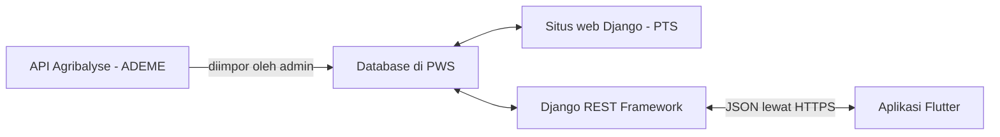

# FoodPrint Mobile

Aplikasi mobile Flutter untuk tracking carbon footprint dari makanan yang kita konsumsi sehari-hari. Aplikasi ini adalah versi mobile dari situs web **FoodPrint** (Proyek Tengah Semester).

> Kelompok : PBP E6

## Anggota Kelompok
| Nama | NPM | GitHub | Modul |
|------|-----|--------|-------|
| Regina Dibrya Kerinne Br Purba | 2506657296 | [reginadibryakerinne](https://github.com/reginadibryakerinne) | Food Catalog & API |
| William Orlando | 2506657390 | [williamorln](https://github.com/williamorln) | Daily Intake Tracker |
| Ilham Naufal Firmansyah | 2506532643 | [RedStone576](https://github.com/RedStone576) | Carbon Goals & Targets |
| Arsya Khairunissa Budiman | 2506544076 | [syakhrnss](https://github.com/syakhrnss) | Custom Meals / Recipes |
| Muhammad Rafif Ananta Marpaung | 2506585151 | [parmaung](https://github.com/parmaung) | Eco-Alternatives Forum / Tips |

## Deskripsi Aplikasi

**Nama aplikasi:** FoodPrint (*food carbon footprint*).

Setiap jenis makanan memiliki carbon footprint yang berbeda, mulai dari produksi bahan, pengolahan, sampai distribusi. Informasi ini belum selalu mudah ditemukan dalam kehidupan sehari-hari, padahal memahaminya adalah langkah awal menuju pola konsumsi yang lebih sadar lingkungan. FoodPrint membantu pengguna mengenali makanan beserta emisinya, mencatat konsumsi harian, dan mengevaluasi pola konsumsi langsung dari ponsel.

Fungsi utama aplikasi:

- **Food Catalog:** menjelajah makanan beserta emisi karbonnya (cari dan filter kategori).
- **Daily Tracker:** mencatat konsumsi harian dan menghitung total emisinya.
- **Carbon Goals:** menetapkan batas emisi dan memantau progresnya.
- **Custom Meals:** meracik paket makanan dan melihat total emisinya.
- **Eco-Alternatives:** berbagi dan menemukan saran makanan pengganti dengan emisi lebih rendah.

### Terminologi

- **Carbon Footprint (Jejak Karbon):** jumlah total gas rumah kaca (khususnya CO2) dari seluruh proses produksi, distribusi, dan konsumsi suatu makanan.
- **Daily Intake (Asupan Harian):** daftar total makanan dan minuman yang dikonsumsi pengguna dalam satu hari.
- **Carbon Goals:** target personal yang diatur pengguna untuk membatasi emisi karbon maksimal dari makanan.
- **Eco-Alternatives:** saran makanan pengganti dengan fungsi/rasa serupa namun jejak karbon yang jauh lebih rendah.

## Peran Pengguna

| Peran | Yang dapat dilakukan |
|-------|----------------------|
| **Tamu** (belum login) | Menjelajah Food Catalog (cari dan filter) dan melihat Eco-Alternatives (akses publik). |
| **User** (sudah login) | Menyimpan histori dan goals, mencatat konsumsi (Daily Tracker), mengatur target emisi (Carbon Goals), meracik paket makanan (Custom Meals),berinteraksi di forum Eco-Alternatives. |
| **Admin** | Mengelola master data makanan dan data emisi karbon di Food Catalog, serta memoderasi forum. |

Otorisasi dicek di server (Django REST Framework), tidak hanya disembunyikan di tampilan aplikasi.

## Modul dan Pembagian Kerja

| Status | Modul | Cakupan di aplikasi mobile | Penanggung jawab |
|--------|-------|----------------------------|------------------|
| TODO | Food Catalog & API | Endpoint DRF `FoodItem` (list, detail, tambah, ubah, hapus); halaman katalog dengan pencarian dan filter kategori; form tambah/ubah/hapus untuk admin; data emisi bersumber dari API publik Agribalyse | Regina Dibrya Kerinne Br Purba (2506657296) |
| TODO | Daily Intake Tracker | Endpoint DRF `ConsumptionLog`; halaman catatan makan harian per user; kalkulasi emisi | William Orlando (2506657390) |
| TODO | Carbon Goals & Targets | Endpoint DRF `CarbonGoal`; halaman target batas emisi per user dengan progress bar tracker | Ilham Naufal Firmansyah (2506532643) |
| TODO | Custom Meals / Recipes | Endpoint DRF `CustomMeal`; halaman paket makanan gabungan beberapa food item dengan kalkulasi total emisi | Arsya Khairunissa Budiman (2506544076) |
| TODO | Eco-Alternatives Forum / Tips | Endpoint DRF `FoodAlternative`; halaman forum saran makanan alternatif rendah karbon (public access) | Muhammad Rafif Ananta Marpaung (2506585151) |

## Penjelasan Alur Pengintegrasian Data

Aplikasi mobile tidak menyimpan data sendiri. Seluruh data tetap berada di database situs web Django (PWS) dari Proyek Tengah Semester, dan aplikasi Flutter mengambil serta mengirim data lewat endpoint Django REST Framework. Dengan begitu, situs web dan aplikasi mobile selalu menampilkan data yang sama.

### 1. Gambaran umum



Hal-hal penting dari diagram di atas:

- **Satu sumber data.** Database di PWS adalah satu-satunya tempat data disimpan. Situs web dan API membaca serta menulis ke database yang sama.
- **Flutter hanya klien.** Aplikasi menampilkan data dari respons JSON dan mengirim perubahan lewat permintaan HTTP. Tidak ada data makanan, catatan, atau target yang ditulis langsung di dalam aplikasi.
- **Django REST Framework sebagai pintu.** *Serializer* mengubah data model menjadi JSON (dan memvalidasi data yang masuk), sedangkan *permission* menentukan siapa yang boleh mengakses.
- **Data emisi tidak diambil Flutter langsung dari Agribalyse.** Nilai `carbon_per_kg` diimpor ke database situs web (oleh admin), lalu dilayani ke aplikasi lewat endpoint DRF. Aplikasi tetap dapat berjalan walau API Agribalyse sedang tidak dapat diakses.

### 2. Daftar endpoint

Base URL: `https://ilham-naufal-foodprint.pws.cs.ui.ac.id/api/v1/`. Di aplikasi, semua alamat ini dicatat di `lib/api/endpoints.dart`.

| Modul | Method | Endpoint | Akses |
|-------|--------|----------|-------|
| Food Catalog | GET | `/api/v1/foods/` (filter `?category=`, `?search=`) | Publik |
| | GET | `/api/v1/foods/<id>/` | Publik |
| Daily Intake Tracker | GET | `/api/v1/intake/` (filter `?date=YYYY-MM-DD`) | Login, hanya catatan sendiri |
| | GET | `/api/v1/intake/<id>/` | Login, hanya catatan sendiri |
| Carbon Goals | GET | `/api/v1/goals/` | Login, hanya target sendiri |
| | GET | `/api/v1/goals/<id>/` | Login, hanya target sendiri |
| Custom Meals | GET | `/api/v1/custom-meals/` | Paket publik + paket sendiri |
| | GET | `/api/v1/custom-meals/<id>/` | Paket publik + paket sendiri (daftar bahan hanya untuk user login) |
| Eco-Alternatives | GET | `/api/v1/eco-alternatives/` (filter `?q=`) | Publik |
| | GET | `/api/v1/eco-alternatives/<id>/` | Publik (termasuk balasan) |

Endpoint untuk menambah, mengubah, dan menghapus data dilanjutkan oleh tiap penanggung jawab modul.

## Setup

```
$ flutter pub get
$ flutter run
```

## Deployment
- 

## Link Figma

[Link Figma](https://www.figma.com/design/JzwVtphEMM1R7hcIT7Le1B/PTS?t=PJLSwtUSlqEdyDIW-1)

Design system aplikasi mobile mengikuti situs web agar selaras.

## AI DISCLOSURE 
1. 001 /